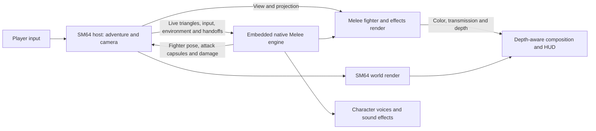

# How the integration works

Super Melee 64 keeps SM64's adventure running and gives its player a native
Melee fighter. The fighter uses Melee's motion states, attacks, damage,
animations, articles and sounds. SM64 still runs the levels, objects, missions,
doors, warps, saves and camera. This document explains that boundary and where
to start when extending it or adapting the approach to another game.

You are welcome to modify, fork and extend the project's original integration
work, including for other games, under its GPL-3.0-or-later licence. Preserve
the applicable notices and meet the licence's source-sharing requirements when
distributing covered work. This does not grant rights to the games, their
assets or third-party source. Read [LICENSING](../LICENSING.md),
[third-party notices](../outputs/sm64-melee-lab/release/THIRD-PARTY.txt) and
[bootstrap provenance](BOOTSTRAP-PROVENANCE.md) before redistributing a port.

## One process, two engines



The normal game loads a dynamic Melee library into the SM64 executable and
calls it directly. It does not run an emulator or a second game process.
Melee's cooperative execution context yields back to SM64 after each requested
simulation tick. macOS uses `ucontext` with a reserved main-thread stack;
Windows uses fibers. The native engine also has its own graphics/audio workers,
so “one process” does not mean “one thread.” Its donor window is kept hidden.

The principal boundaries are:

| Part | Source and responsibility |
| --- | --- |
| Host adapter | [sm64_host_bridge.c](../outputs/sm64-melee-lab/native/sm64_host_bridge.c): startup, simulation schedule, player proxy, environment and adventure handoffs |
| Melee entry points | [melee_embedded.c](../outputs/sm64-melee-lab/native/melee_embedded.c): context switching, input, snapshots and selected native render passes |
| Shared structures | [bridge_protocol.h](../outputs/sm64-melee-lab/native/bridge_protocol.h): commands, surfaces, poses, attacks and render requests |
| Native world adapter | [melee_world.inc](../outputs/sm64-melee-lab/native/melee_world.inc): live geometry, collision slices, ledges and stairs |
| Graphics transfer | [melee_gpu.cpp](../outputs/sm64-melee-lab/native/melee_gpu.cpp), [build_compositor.py](../outputs/sm64-melee-lab/native/build_compositor.py), [sm64_gl_composite.inc](../outputs/sm64-melee-lab/native/sm64_gl_composite.inc) |
| Single-player host hooks | [prepare_sm64_host.py](../outputs/sm64-melee-lab/native/prepare_sm64_host.py) |
| Co-op host hooks | [prepare_coop_host.py](../outputs/sm64-melee-lab/native/prepare_coop_host.py) |

Some socket-worker and exported-mesh code remains from earlier experiments.
The supported launchers use `SM64_MELEE_LIBRARY` and the direct-call path. A new
integration should start there.

## Simulation, coordinates and collision

During active fighter play, each SM64 update at **30 Hz** requests **two Melee
ticks at 60 Hz**. One-shot events such as a spawn or launch are consumed once;
held input and continuing environment state survive the second tick. The host
checks the command sequence against the returned snapshot. Pauses, menus and
host-owned cutscenes are explicit handoff states rather than a free-running
second simulation.

Both worlds use Y as height and X/Z as the horizontal plane. This integration
uses **10 SM64 units per Melee unit**:

| Quantity | Conversion |
| --- | --- |
| SM64 position, collision vertex or water height → Melee | multiply by `0.1` |
| Melee position or attack radius → SM64 | multiply by `10` |
| SM64 velocity in units per 30 Hz update → Melee units per 60 Hz tick | multiply by `0.05` |
| Melee per-tick displacement → SM64 velocity field | multiply by `20` |

Keep those conversions together when changing scale. Changing only the model
size leaves hitboxes, step heights, cannon travel and camera distances out of
agreement. Host angles also need conversion from SM64's 16-bit turn to radians;
matrix layout and depth conventions are converted separately for rendering.

Melee's original movement callbacks operate in a fighter's horizontal lane
and vertical plane. The bundled 3D adapter rotates that lane in world space,
projects nearby 3D triangles into native collision lines, then returns the
fighter to world space. [melee_world.inc](../outputs/sm64-melee-lab/native/melee_world.inc)
supplies SM64's current static and dynamic triangles to that machinery. The
world-space capsule guard in [melee_terrain.inc](../outputs/sm64-melee-lab/native/melee_terrain.inc)
also constrains high-speed travel against barriers. Stair smoothing and
supported step-down handling complement the native collision callbacks.

The host republishes live geometry before stepping. Static triangles retain
stable slots; moving object triangles retain slots associated with their
object and ordinal. A changed world revision rebuilds the collision world and
retires old world articles. Do not renumber a ledge while a fighter hangs from
it. The current SM64 publisher has a **4,095-surface budget**; a larger host
needs a reviewed capacity change, not silent truncation.

Ordinary fighter movement is authoritative in Melee. Its resulting position
updates SM64's invisible player object so original triggers and object
interactions still work. SM64's ordinary player movement collision is bypassed
while that fighter path is active. Moving platforms contribute translation and
yaw back into the fighter. Painting sensor faces are excluded from solid
Melee walls while their original warp interactions remain active.

## Adventure actions and combat

The host proxy is an interface to the original adventure, not a second visible
Mario. Some actions briefly return movement ownership to SM64:

| Situation | Boundary behavior / extension point |
| --- | --- |
| Doors, carrying, scripted movement, star sequences | SM64 performs its original action; the adapter follows or presents the appropriate fighter pose. See [sm64_host_bridge.c](../outputs/sm64-melee-lab/native/sm64_host_bridge.c). |
| Cannons and enemy throws | SM64 handles hold/aim/release; a one-shot launch vector enters native tumble/travel. See [melee_environment.inc](../outputs/sm64-melee-lab/native/melee_environment.inc). |
| Steep slides | SM64 supplies slope acceleration and steering; Melee supplies the crouch pose and collision. |
| Shells and Wing Cap flight | SM64 owns traversal and world objects; [melee_traversal.inc](../outputs/sm64-melee-lab/native/melee_traversal.inc) supplies the hosted pose. |
| Water | The host samples water/air and the native adapter changes drag, descent, depth controls and recovery resources while retaining attacks and specials. See [sm64_air.inc](../outputs/sm64-melee-lab/native/sm64_air.inc), [sm64_npc_water.inc](../outputs/sm64-melee-lab/native/sm64_npc_water.inc) and [melee_traversal.inc](../outputs/sm64-melee-lab/native/melee_traversal.inc). |
| Metal and Vanish Caps | Map host cap state onto native fighter materials/power-ups in [melee_powerups.inc](../outputs/sm64-melee-lab/native/melee_powerups.inc). |
| Death, respawn and character change | Reset the appropriate owned fighter state, clean up articles and present Melee's rebirth platform. A star uses native victory presentation. |

Melee-vs-Melee combat keeps native percentage, weight, hitstun, shields and
knockback. For SM64 objects, exported **attack capsules** are tested against
their hurt volumes and translated into original SM64 attack messages in
[sm64_combat.inc](../outputs/sm64-melee-lab/native/sm64_combat.inc). Ground attacks,
ground pounds and projectiles therefore enter the original enemy behavior
logic. Native grab capsules also initiate eligible SM64 grabs, including
Bowser's tail, after which the host owns the carrying interaction.

[melee_items.inc](../outputs/sm64-melee-lab/native/melee_items.inc) exports native
articles and their hit capsules, sends world contact back to the article, and
uses native impact effects/sounds. Cleanup must clear fighter-held article
references before retiring their objects; simply deleting a projectile can
leave a tether or held-arrow callback pointing at freed memory.

In the other direction, world damage becomes a native fighter reaction. NPC
sampling lives in [sm64_npc_environment.inc](../outputs/sm64-melee-lab/native/sm64_npc_environment.inc)
and enters the native actor functions in
[melee_actor_environment.inc](../outputs/sm64-melee-lab/native/melee_actor_environment.inc).
Coins remove ten damage percentage points per coin value and feed the SM64 air
accounting. Damage/air accounting uses actual applied native damage so blocked
attacks do not drain air twice. Fatal host hazards still own adventure death.

## Input, camera, rendering and audio

The host owns physical keyboard/controller sampling. `SmbInput` carries native
button bits, movement, attack modifiers, look input and environment flags;
`m3d_lab_pad` supplies that command to Melee. Camera buttons are mapped separately
from grab/shield/attack inputs. The normal camera is SM64's, with extra follow
distance, bounded momentary look and combat framing. An optional Melee camera
path remains available. Input and camera changes should be tested together.

The native renderer receives the **actual host view/projection matrices and
framebuffer dimensions**. It draws fighters, articles, accessories and effects
without the donor map. Native material/model visibility passes are retained:
they are needed for Bowser's shell, Sonic's ball, equipment, shields and the
flat Game & Watch model. SM64 draws the floor-projected circle shadows.

Composition uses three outputs: signed floating-point color **C**, RGB
background transmission **T**, and depth. The final color is:

```text
final RGB = C + SM64 world RGB × T
```

This carries ordinary transparency as well as additive, subtractive and
darkening effects; a black-background cutout or alpha-only screenshot loses
those operations. Depth is converted between the native renderer's reversed
depth and OpenGL. Transparent particles and cloaked geometry also receive a
coverage-depth pass so scenery can occlude them correctly. The native damage
HUD is a separate overlay drawn **after all SM64 scenery**, without modifying
the world's depth buffer.

The current graphics path synchronously reads the native GPU buffers and
uploads them to the host's OpenGL compositor. This is an explicit performance
cost, even inside one process. [sm64_video.inc](../outputs/sm64-melee-lab/native/sm64_video.inc)
caps the complete scene at 1080 pixels high by default and measures frame
timing. `SMB_RENDER_MAX_HEIGHT` changes that cap; it applies to both engines.

SM64 keeps its soundtrack and world audio. Melee's native audio path plays
fighter voices and effects, with donor music muted by
[build_adventure.py](../outputs/sm64-melee-lab/native/build_adventure.py). Mario
voice calls that would duplicate the fighter are suppressed by the host.
The recording hooks capture both audio streams plus the completed picture;
they do not provide a general audio interface for another host automatically.

## Enemies and multiplayer

[campaign.json](../outputs/sm64-melee-lab/native/campaign.json) is the editable
stage/character/wave plan. [build_campaign.py](../outputs/sm64-melee-lab/native/build_campaign.py)
validates it and generates the encounter and recommended-start tables.
[sm64_npcs.inc](../outputs/sm64-melee-lab/native/sm64_npcs.inc) owns safe placement,
head starts, catch-up, rounds and KOs; [melee_npcs.inc](../outputs/sm64-melee-lab/native/melee_npcs.inc)
owns native CPU creation, difficulty and presentation. The host supplies live
terrain/environment samples instead of the donor map's navigation assumptions.
Ice Climbers' partner is a separate native actor, not a visual attachment.

Co-op uses Coop Deluxe's existing player/object/warp transport. It is not
deterministic input lockstep or rollback. Each machine simulates its own player
and presents remote players from validated motion/frame/model snapshots.
The victim's owner resolves received hit capsules against its native hurt
capsules and writes that fighter's damage/knockback. Grabs have a separate
ownership protocol. See [sm64_coop.inc](../outputs/sm64-melee-lab/native/sm64_coop.inc),
[sm64_coop_transport.inc](../outputs/sm64-melee-lab/native/sm64_coop_transport.inc),
[melee_remote.inc](../outputs/sm64-melee-lab/native/melee_remote.inc) and
[melee_network_combat.inc](../outputs/sm64-melee-lab/native/melee_network_combat.inc).

Each stage/act encounter has one CPU authority: the participating player with
the lowest global ID. Other clients render those CPUs as proxies. A shared
ledger preserves defeated fighters, wave/round identity, percentages and air
when authority changes; separate area poses avoid duplicating an encounter
across rooms. The implementation targets 16 human connections plus up to three
stage CPUs. The beta's live network acceptance covers two clients, not a
sixteen-person Internet session.

The bridge structures and the multiplayer wire format are different contracts.
The current integration layout is referred to as **native14**; its shared
`SMB_MAGIC` is `0x534d423e`, and the library build exports 48 `smb_embed_*`
functions. The local call boundary assumes matching compiled layouts on a
little-endian machine; the magic alone is not a general ABI negotiation scheme.
Network messages add connection-bound sender checks, scene/authority checks,
count bounds and sequence/chunk handling. They send authored state, not native
pointers. All peers must use matching builds. Changing a shared struct requires
reviewing both paths and updating incompatible-build rejection. See
[SECURITY](../SECURITY.md) for the limits of this peer-trust model.

## Adapting this to another game

See the [porting guide](PORTING.md) for entry-point details and a staged
implementation plan. The outline below summarizes the main boundaries.

This is a working example of a native host adapter, not a plug-in SDK that can
be dropped into an arbitrary executable. A different host needs source access
or suitable supported hooks for simulation, collision, rendering and input.
Start with a single-player flat test area and add the adventure features
incrementally:

1. **Build the existing integration first.** Use your own game images and the
   [setup instructions](../outputs/sm64-melee-lab/release/START%20HERE.txt). This
   verifies the native toolchain before introducing another host. Keep the new
   game's adapter separate from the frozen dependency/build snapshot.
2. **Define coordinates, time and ownership.** Choose the host-to-Melee scale,
   axis/angle conversions and a fixed 60 Hz native schedule. Use an accumulator
   if the new host has variable updates. Decide exactly when the host takes
   movement control and when it returns it; do not run two competing movement
   solvers on one player.
3. **Boot and step one fighter.** Follow `smb_host_boot` and `smb_embed_init` /
   `smb_embed_step`. Supply the local disc/resources, preserve the library for
   its engine lifetime, provide the platform-specific execution context, and
   shut it down before destroying the host graphics/audio infrastructure.
4. **Publish live collision.** Send world-space `SmbSurface` triangles through
   `smb_embed_world`; preserve normals, collision/sensor semantics, stable
   moving-surface identities and world revisions. Verify floors, ceilings,
   thin walls, stairs, moving platforms and ledges before loading a full map.
5. **Replace the host player visually.** Drive its interaction proxy from the
   native output, suppress its duplicate model, and supply camera matrices to
   `smb_embed_render`. Match projection, depth, dimensions and render ordering.
   A non-OpenGL host will need its own compositor/graphics transfer path.
6. **Translate gameplay events deliberately.** Consume `SmbHit` capsules into
   the host's enemy/trigger API; return impacts and world damage through the
   native entry points. Decide how that game's pickups, health, hazards,
   swimming, scripted movement and death map onto Melee. SM64-specific action
   IDs and attack messages cannot be copied unchanged into another engine.
7. **Add audio and lifecycle tests.** Keep the native effects while avoiding
   duplicate soundtrack/voice playback. Test death, reload, character changes,
   article teardown and world unloads; stale native object references are more
   dangerous than a bad pose. Add multiplayer only after this local seam works.

The public source adapter bundle contains the 3D lane/collision implementation
and its build tools. Its member manifest pins the inputs; see
[build_bootstrap.py](../outputs/sm64-melee-lab/native/build_bootstrap.py) and
[bootstrap provenance](BOOTSTRAP-PROVENANCE.md). Modify the preferred source
and regenerate/verify a new bundle identity and manifest when changing those
inputs. Editing generated build copies alone will be overwritten on rebuild.
The game-data structures require the existing GCC scalar-storage-order
boundary; do not pass raw disc-backed structs across arbitrary C/C++ compilers.

For changes confined to this host, `build_adventure.py` rebuilds the native
adapter and single-player integration from the prepared snapshot;
`build_coop.py` prepares/builds the separate co-op host. Both host patch scripts
assert their pinned source boundaries. Update those patches instead of editing
only generated `work/` trees. The installer and explicit packaging lists must
also include every new required source file.

## Testing an extension

[CONTRIBUTING](../CONTRIBUTING.md) lists the asset-free tests. With a completed
local Mac build, a focused real-engine smoke example is:

```sh
python3 outputs/sm64-melee-lab/native/play_embedded.py \
  --smoke --character link --difficulty none --all-stars \
  --scenario cannon-range --frames 320 --timeout 180
```

Use the nearest scenario in `play_embedded.py` when adding a regression. The
full [verify_beta.py](../outputs/sm64-melee-lab/native/verify_beta.py) suite runs
stage entry, roster and integration checks with isolated saves;
`verify_coop_features.py all` adds actual two-client movement, combat,
projectile, grab, campaign and round cases. Do not rebuild native code while a
suite is exercising its compiled engines. Record the tested commit, platform,
inputs and remaining limits; passing these bounded checks does not prove every
mission, every modded character move or a new host's full campaign.

Distribute the integration source, build tooling and the applicable notices.
Keep game images, extracted assets and locally built game binaries out of the
repository and releases. Preserve the local-input installation model for a
new host unless you independently have permission to distribute its content.
